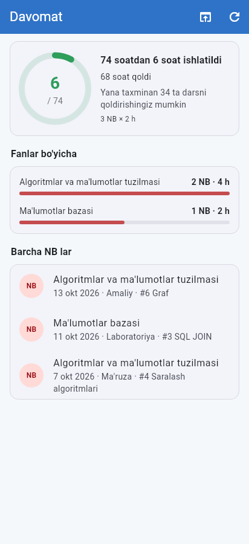

# TuitMate: a personal TUIT LMS app with AI (Windows + Android)

TuitMate is a personal, **unofficial** companion for [lms.tuit.uz](https://lms.tuit.uz), similar to TuitGPT.
It shows everything from your LMS in a fast, clean app, sends notifications, and adds an AI study assistant.

> Not affiliated with TUIT. It reads the same pages you see after signing in to LMS,
> and only writes to LMS when **you** upload an answer.

<p>
  
  
  
</p>


*(Screenshots use sample data.)*

## Features

| | |
|---|---|
| **Today** | Current / next class with countdown, today's classes with breaks, upcoming deadlines, absence meter, next exam |
| **Schedule** | Weekly timetable from LMS with **odd / even week** handling (*toq / juft*, left/right side). If the week is wrong, tap **"Wrong week?"** to correct it. Lesson topics for that date come from the course calendar. |
| **Deadlines** | All assignments from every course: deadline, countdown, grade, teacher file. Filters: *not submitted / submitted / graded / overdue*. **Upload your answer (≤ 50 MB)** straight from your phone or PC. |
| **Courses & grades** | Rating per course (points, %, grade), assignment list, lectures/practicals/labs with **teacher files** to download, and your full study plan with grades. |
| **Attendance** | Hours used against the **74-hour** semester limit (1 NB = 2 academic hours; both are adjustable), how many classes you can still miss, per-subject breakdown, list of every NB. |
| **Exams** | Exam date, time, room and format, with a countdown; final scores colour-coded on the 100-point scale; test points. |
| **News** | LMS dashboard news. |
| **Notifications** | New assignment, changed deadline, new grade, exam result or change, new absence, news, deadline reminders (24 h and 3 h before), optional "class in 10 minutes" reminders. On Android checks run in the background every 15–120 min, even when the app is closed. On Windows they run while the app is open. |
| **AI assistant** | A chat that knows your timetable, deadlines, grades, attendance and exams. Attach PDFs, Word, PowerPoint, Excel, images or text, or tap **Ask AI** on any teacher file or assignment. Replies support formulas (LaTeX) and code. |
| **Ask in ChatGPT** | You have ChatGPT Plus but no API key, so this button copies your question **together with your LMS context**, then opens ChatGPT (browser or app) so you can paste it there. |
| **LMS website** | The full lms.tuit.uz inside the app, already signed in, for anything not covered above. |
| Languages | O'zbekcha, Русский, English · light / dark theme |

## Install

### Android
1. Download `TuitMate.apk` (see *Getting the builds* below).
2. Open it on your phone and allow **Install unknown apps** for your browser or file manager when Android asks.
3. Open TuitMate and allow notifications.

### Windows 10 / 11
- **Installer:** run `TuitMate-Setup.exe`. It installs for your user only, so no admin rights are needed. Tick *Start with Windows* if you want notifications all day.
- **Portable:** unzip `TuitMate-windows-portable.zip` anywhere and run `TuitMate.exe`.
- Login uses Microsoft Edge WebView2, which Windows 10/11 already include. If login shows a blank page, install the *WebView2 Runtime* from Microsoft.

## First start

1. Tap **Sign in to LMS**. The real lms.tuit.uz login page opens inside the app.
2. Enter your login and password and press **Kirish**, or use **OneID**.
3. That's it. Your data loads, and the app keeps your session. With *Remember password* on, the app signs you in again automatically when LMS ends your session. The password is stored only in the device keystore (Android Keystore / Windows Credential Manager).

> Why the in-app login page? LMS protects login with Google reCAPTCHA. Signing in on the real page
> lets reCAPTCHA work normally instead of bypassing it.

## Set up the free AI (2 minutes)

ChatGPT Plus doesn't include API access, so the built-in assistant uses **Google Gemini**, which has a free tier:

1. Open <https://aistudio.google.com/apikey> and sign in with any Google account.
2. Click **Create API key** and copy it.
3. In TuitMate, open **AI → Settings** (or the setup card on the AI tab), paste the key, then **Save** → **Test**.

You can change the model in *AI settings → Load models*. The default is `gemini-flash-latest`.
Other providers work too: **Groq** (free tier), **OpenRouter**, **OpenAI**, or any OpenAI-compatible API.
Only Gemini reads PDFs directly. Word, PowerPoint, Excel and text files work with every provider.

## Getting the builds

### Option A: GitHub builds them for you (recommended)
The repo includes `.github/workflows/build.yml`:
- Every push to `main` builds `TuitMate.apk` and the Windows app. Download them under **Actions → latest run → Artifacts**.
- Push a tag such as `v1.0.0` (`git tag v1.0.0 && git push --tags`) and they're also attached to a **GitHub Release**.

#### Keep Android updates working (one-time step)
Android only installs a new APK over the old one if both are signed with the **same key**.
Add your signing key to the repository once:

1. On GitHub open **Settings → Secrets and variables → Actions → New repository secret**.
2. **Name:** `ANDROID_KEYSTORE_BASE64`. **Secret:** the whole contents of the `ANDROID_KEYSTORE_BASE64.txt` file (one long line).
3. Save. Every build after that is signed with this key, so it updates the installed app and keeps your data.

Optional secrets, if you use your own keystore: `ANDROID_KEYSTORE_PASSWORD` (default `android`), `ANDROID_KEY_ALIAS`
(default `androiddebugkey`) and `ANDROID_KEY_PASSWORD` (defaults to the keystore password).
Never commit the keystore to the repository, and keep a backup: if the key is lost, the app has to be
uninstalled (losing its data) before a build with a new key can be installed.

No key file yet? Make one (`keytool` comes with any JDK or Android Studio):

```bash
keytool -genkeypair -keystore upload.jks -storetype PKCS12 -alias androiddebugkey -keyalg RSA -keysize 2048 \
  -validity 10000 -storepass android -dname "CN=TuitMate"
base64 -w0 upload.jks > ANDROID_KEYSTORE_BASE64.txt          # Linux / macOS
```

On Windows (PowerShell): `[Convert]::ToBase64String([IO.File]::ReadAllBytes("upload.jks")) | Set-Content -NoNewline ANDROID_KEYSTORE_BASE64.txt`

### Option B: Build on your PC
1. Install [Flutter](https://docs.flutter.dev/get-started/install) (3.47 or newer). For Windows builds, also install Visual Studio 2022 or 2026 with *Desktop development with C++*.
2. In this folder:
   ```bash
   flutter pub get
   flutter build windows --release      # → build/windows/x64/runner/Release/TuitMate.exe
   flutter build apk --release          # → build/app/outputs/flutter-apk/app-release.apk
   ```

## Project layout

```
lib/
  lms/        LMS client (session cookies, endpoints), HTML/JSON parsers, data snapshot, change detection
  core/       settings, storage (cache + keystore), timetable/odd-even week + attendance math, texts (uz/ru/en), formatting
  services/   notifications, Android background checks (WorkManager)
  ai/         Gemini / OpenAI-compatible streaming, LMS context for the AI, file text extraction, chat history
  ui/         screens (Today, Schedule, Deadlines, Courses, Attendance, Exams, News, AI, Profile/Settings, LMS website)
test/         parser and logic tests (flutter test)
```

## If something looks wrong

LMS sometimes changes its pages. Each screen has an **Open in LMS** button (🌐) that shows the original page, and the
**LMS website** tab always works. Parsers live in `lib/lms/parsers.dart`. Selectors are in one place, so a fix is usually one line.

## Privacy

- Your LMS password and AI keys are kept in the OS keystore and never sent anywhere except lms.tuit.uz (password) or the AI provider you chose (key).
- Your LMS data is cached on your device for offline use.
- The AI only receives your LMS summary when **Use my LMS data** is on (AI tab → ⋮ menu).
