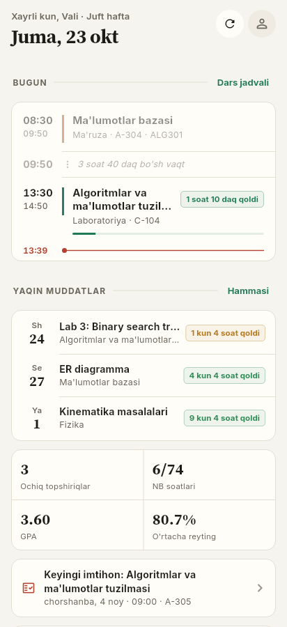
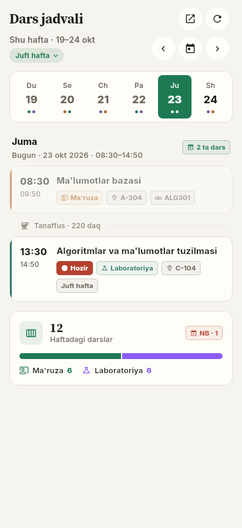
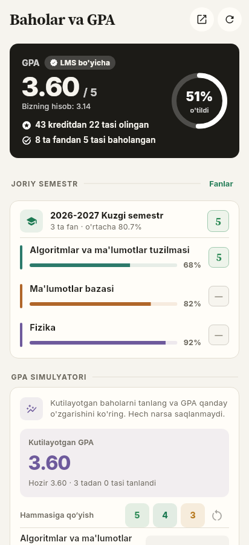
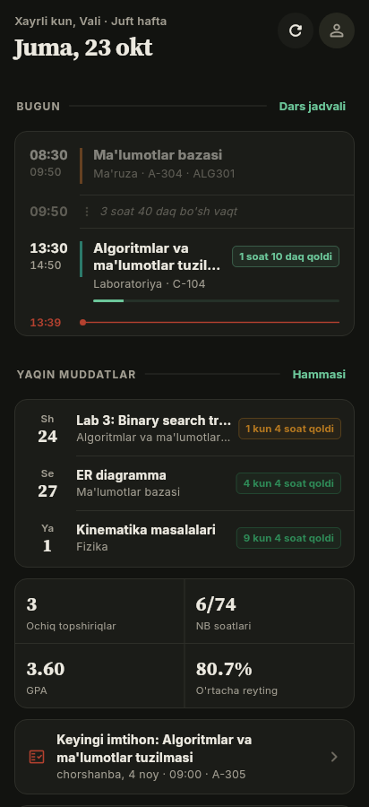
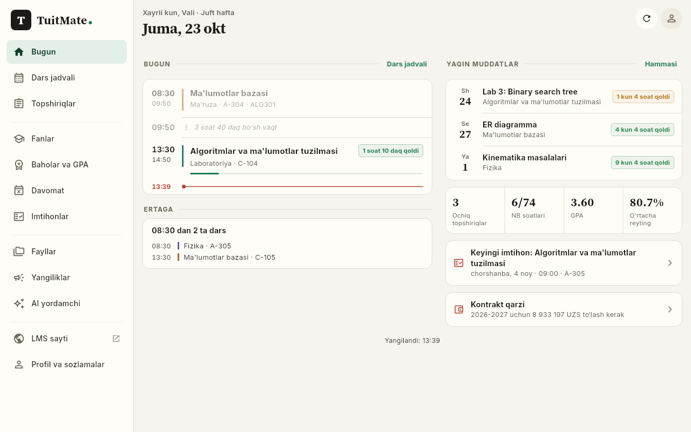

# TuitMate: a personal TUIT LMS app with AI (Windows + Android)

[](https://github.com/comfysh/tuitgptclone/actions/workflows/build.yml)
[](https://github.com/comfysh/tuitgptclone/releases/latest)
[](https://github.com/comfysh/tuitgptclone/releases)

[](LICENSE)

**[⬇ Download the latest version](https://github.com/comfysh/tuitgptclone/releases/latest)**: `TuitMate-<version>.apk` for Android,
`TuitMate-<version>-Setup.exe` for Windows.

TuitMate is a personal, **unofficial** companion for [lms.tuit.uz](https://lms.tuit.uz): your day as a calm
agenda, everything from your LMS in one place, quiet notifications that work without opening the app, an AI study
assistant with the provider of your choice, and encrypted automation for n8n.

> Not affiliated with TUIT. It reads the same pages you see after signing in to LMS,
> and only writes to LMS when **you** upload an answer.

<p>
  
  
  
  
</p>


*(Screenshots use sample data.)*

## Features

| | |
|---|---|
| **Today** | Your day as an **agenda**: classes, free time between them, tasks due today and exams, with a red *now* line and a countdown. Then what is due in the coming days, open tasks, NB hours, GPA, average rating, tomorrow's classes, the next exam and tuition debt. |
| **Schedule** | Week strip with dates on phones, a full **weekly grid** on PC. **Odd / even weeks** (*toq / juft*) handled automatically; tap the week tag to correct it. Classes you missed are marked **NB**. Lesson topics for that date come from the course calendar. |
| **Tasks** | Every assignment grouped by *overdue / today / tomorrow / this week / later / waiting for grade / graded*, with search and course filters. The task sheet shows the criteria, the teacher's file, your answer and the grade. **Upload your answer (≤ 50 MB)** straight from your phone or PC. |
| **Courses** | Rating per course and the grade it is heading for (from the work graded so far, so tasks that aren't due yet don't drag it down), a **grade forecast** (how many points you still need for a 3, 4 or 5), lectures / practicals / labs with **teacher files** and your NBs, and the written exam questions. |
| **Grades & GPA** | GPA (as the LMS shows it), credits earned, grade distribution, every semester of your study plan, and a **GPA simulator**: pick the grades you expect and see your new GPA. |
| **Files** | Every teacher file of the semester in one place: search, filter by type or course, open, or **Ask AI** about it. |
| **Attendance** | Hours used against the **74-hour** semester limit (1 NB = 2 academic hours; both adjustable), how many classes you can still miss, per-subject breakdown, every NB (excused ones marked). |
| **Exams** | Exam date, time, room and format with a live countdown, results, test points, written questions. |
| **News** | LMS news with a full article view. |
| **Home-screen widget** (Android) | *TuitMate · Today*: the current or next class, the nearest deadline, today's classes, open tasks and NB hours. Updates itself at each class start and end, even when the app is closed. |
| **Notifications** | New assignment, changed deadline, new grade, exam result or change, new absence, new teacher file, news, deadline reminders (24 h and 3 h before), optional "class in 10 minutes" reminders. **Not annoying:** quiet hours (silent at night), several updates arrive as one notification, a morning brief with today's classes and deadlines, and you pick which kinds notify you. **No need to open the app:** on Android checks run in the background every 15–120 min, and when LMS ends the session TuitMate signs in again by itself (with *Remember password*). On Windows TuitMate keeps running in the **system tray**. |
| **AI assistant** | A chat that knows your timetable, deadlines, grades, attendance and exams. Attach PDFs, Word, PowerPoint, Excel, images or text, or tap **Ask AI** on any teacher file or assignment. Replies support formulas (LaTeX) and code. Works with **Gemini, DeepSeek, OpenRouter, Groq, Mistral, OpenAI, Together, xAI, local models (Ollama / LM Studio)** or any OpenAI-compatible API. |
| **Ask in ChatGPT** | You have ChatGPT Plus but no API key, so this button copies your question **together with your LMS context**, then opens ChatGPT (browser or app) so you can paste it there. |
| **LMS website** | The full lms.tuit.uz inside the app, already signed in, for anything not covered above. |
| **Automation** (owner only) | Sends your LMS events (new tasks, deadlines, grades, NB, exams, files, news, a daily summary) to your own **n8n** workflow or server, **encrypted with AES-256-GCM** and signed. Includes a ready n8n workflow and a guide you can give to ChatGPT or Codex: [docs/AUTOMATION.md](docs/AUTOMATION.md). |
| Languages | O'zbekcha, Русский, English · light / dark theme |

## Install

All files are on the [**Releases**](https://github.com/comfysh/tuitgptclone/releases/latest) page:

| File | For |
|---|---|
| `TuitMate-<version>.apk` | Android 7.0 or newer |
| `TuitMate-<version>-Setup.exe` | Windows 10 / 11 (64-bit) installer |
| `TuitMate-<version>-windows-portable.zip` | Windows without installing |
| `SHA256SUMS.txt` | Checksums to check the files (see [SECURITY.md](SECURITY.md)) |

### Android
1. Download `TuitMate-<version>.apk` on your phone.
2. Open it and allow **Install unknown apps** for your browser or file manager when Android asks.
3. Open TuitMate and allow notifications. Long-press the home screen → **Widgets** → *TuitMate* to add the widget.

A new version installs over the old one and keeps your data (as long as it is signed with the same key, see below).

### Windows 10 / 11
- **Installer:** run `TuitMate-<version>-Setup.exe`. It installs for your user only, so no admin rights are needed. Tick *Start with Windows* if you want notifications all day: TuitMate then starts hidden in the system tray.
- Closing the window keeps TuitMate in the tray (turn this off in *Profile › Notifications*). Right-click the tray icon to quit.
- **Portable:** unzip `TuitMate-<version>-windows-portable.zip` anywhere and run `TuitMate.exe`.
- The app is not code-signed, so Windows may say *"Windows protected your PC"*: choose **More info → Run anyway**.
- Login uses Microsoft Edge WebView2, which Windows 10/11 already include. If login shows a blank page, install the *WebView2 Runtime* from Microsoft.

### Check a download
Compare the file's SHA-256 with `SHA256SUMS.txt` from the same release:
- Windows (PowerShell): `Get-FileHash .\TuitMate-<version>-Setup.exe -Algorithm SHA256`
- Linux / macOS / Termux: `sha256sum -c SHA256SUMS.txt --ignore-missing`

## First start

1. Tap **Sign in to LMS**. The real lms.tuit.uz login page opens inside the app.
2. Enter your login and password and press **Kirish**, or use **OneID**.
3. That's it. Your data loads, and the app keeps your session. With *Remember password* on, the app signs you in again automatically when LMS ends your session. The password is stored only in the device keystore (Android Keystore / Windows Credential Manager).

> Why the in-app login page? LMS protects login with Google reCAPTCHA. Signing in on the real page
> lets reCAPTCHA work normally instead of bypassing it.

## Set up the AI (2 minutes)

ChatGPT Plus doesn't include API access, so the built-in assistant uses an API key. **Google Gemini** has a free tier:

1. Open <https://aistudio.google.com/apikey> and sign in with any Google account.
2. Click **Create API key** and copy it.
3. In TuitMate, open **AI → Settings** (or the setup card on the AI tab), paste the key, then **Save** → **Test**.

You can change the model in *AI settings → Load models*. The default is `gemini-flash-latest`.

Other providers: pick one in *AI settings*, paste its key, **Save** → **Test**.
- **DeepSeek**: key from <https://platform.deepseek.com/api_keys> (pay-as-you-go, very cheap).
- **Groq** (free tier), **OpenRouter** (some free models), **Mistral**, **OpenAI**, **Together**, **xAI**.
- **Local**: Ollama or LM Studio on your PC, no key needed.
- **Custom**: any OpenAI-compatible API (base URL + key).

Each provider keeps its own key and model, so you can switch back and forth.
Only Gemini reads PDFs directly. Word, PowerPoint, Excel and text files work with every provider.

## Getting the builds

### Option A: GitHub builds them for you (recommended)
The repo includes `.github/workflows/build.yml`:
- Every push to `main` runs the tests and builds the APK and the Windows app (**Actions → latest run → Artifacts**).
- **Releases are automatic:** when `main` has a version that has no release yet, the workflow publishes
  release `v<version>` with the APK, the Windows installer, the portable zip, `SHA256SUMS.txt` and the notes
  from [CHANGELOG.md](CHANGELOG.md). To publish a new version:
  1. add a `## [1.1.1] - date` section to `CHANGELOG.md`,
  2. set `version: 1.1.1+3` in `pubspec.yaml` and `appVersion = '1.1.1'` in `lib/core/version.dart`
     (a test checks that they match),
  3. push to `main`.
- **Rebuild a release** (for example after adding the signing key below): **Actions → Build apps → Run workflow**
  on `main`. It replaces the release of the current version with fresh files.
- Pushing a tag such as `v1.0.0` also publishes (or refreshes) that release.

#### Keep Android updates working (one-time step)
Android only installs a new APK over the old one if both are signed with the **same key**.
Add your signing key to the repository once:

1. On GitHub open **Settings → Secrets and variables → Actions → New repository secret**.
2. **Name:** `ANDROID_KEYSTORE_BASE64`. **Secret:** the whole contents of the `ANDROID_KEYSTORE_BASE64.txt` file (one long line).
3. Save. Every build after that is signed with this key, so it updates the installed app and keeps your data.

Optional secrets, if you use your own keystore: `ANDROID_KEYSTORE_PASSWORD` (default `android`), `ANDROID_KEY_ALIAS`
(default `androiddebugkey`) and `ANDROID_KEY_PASSWORD` (defaults to the keystore password).
Never commit the keystore to the repository, and keep a backup: if the key is lost, the app has to be
uninstalled (losing its data) before a build with a new key can be installed.

No key file yet? Make one (`keytool` comes with any JDK or Android Studio):

```
keytool -genkeypair -keystore upload.jks -storetype PKCS12 -alias androiddebugkey -keyalg RSA -keysize 2048 -validity 10000 -storepass android -dname "CN=TuitMate"
```

Then turn it into one line of text:
- Linux / macOS: `base64 -w0 upload.jks > ANDROID_KEYSTORE_BASE64.txt`
- Windows (PowerShell): `[Convert]::ToBase64String([IO.File]::ReadAllBytes((Resolve-Path upload.jks).Path)) | Set-Content -NoNewline ANDROID_KEYSTORE_BASE64.txt`

### Option B: Build on your PC
1. Install [Flutter](https://docs.flutter.dev/get-started/install) (3.47 or newer). For Windows builds, also install Visual Studio 2022 or 2026 with *Desktop development with C++*.
2. In this folder:
   ```bash
   flutter pub get
   flutter build windows --release      # → build/windows/x64/runner/Release/TuitMate.exe
   flutter build apk --release          # → build/app/outputs/flutter-apk/app-release.apk
   ```

## Project layout

```
lib/
  lms/        LMS client (session cookies, endpoints), HTML/JSON parsers, data snapshot, change detection
  core/       settings, storage (cache + keystore), timetable/odd-even week + attendance math, grade forecast and
              expected grade, file library, texts (uz/ru/en), formatting
  services/   notifications, background checks (WorkManager) and background sign-in, Windows tray,
              Android home-screen widget data, automation (encrypted webhooks)
  ai/         AI providers (Gemini, DeepSeek, OpenAI-compatible), streaming, LMS context, file text, chat history
  ui/         design system (design.dart, cards.dart) and screens (Today, Schedule, Tasks, Courses, Grades & GPA,
              Attendance, Exams, Files, News, AI, Profile/Settings, LMS website)
android/…/TuitWidgetProvider.kt   the home-screen widget
test/         parser and logic tests, and every screen rendered at phone / PC size and in dark mode (flutter test)
docs/AUTOMATION.md, docs/automation/   automation guide, n8n workflow, Node.js / Python decoders
```

## If something looks wrong

LMS sometimes changes its pages. Each screen has an **Open in LMS** button (🌐) that shows the original page, and the
**LMS website** tab always works. Parsers live in `lib/lms/parsers.dart`. Selectors are in one place, so a fix is usually one line.

## Privacy

- Your LMS password and AI keys are kept in the OS keystore and never sent anywhere except lms.tuit.uz (password) or the AI provider you chose (key).
- Your LMS data is cached on your device for offline use.
- The AI only receives your LMS summary when **Use my LMS data** is on (AI tab → ⋮ menu).
- Automation events go only to the webhook URL you set, encrypted with your own key.
- **Sign out** (Profile) deletes the cached data, chats, saved password, AI keys, the automation key and the widget's data.
- More in [SECURITY.md](SECURITY.md), including how to report a security problem privately.

## License

[MIT](LICENSE). The Inter and Source Serif 4 fonts are under the SIL Open Font License 1.1. TuitMate is unofficial and not affiliated with TUIT.
